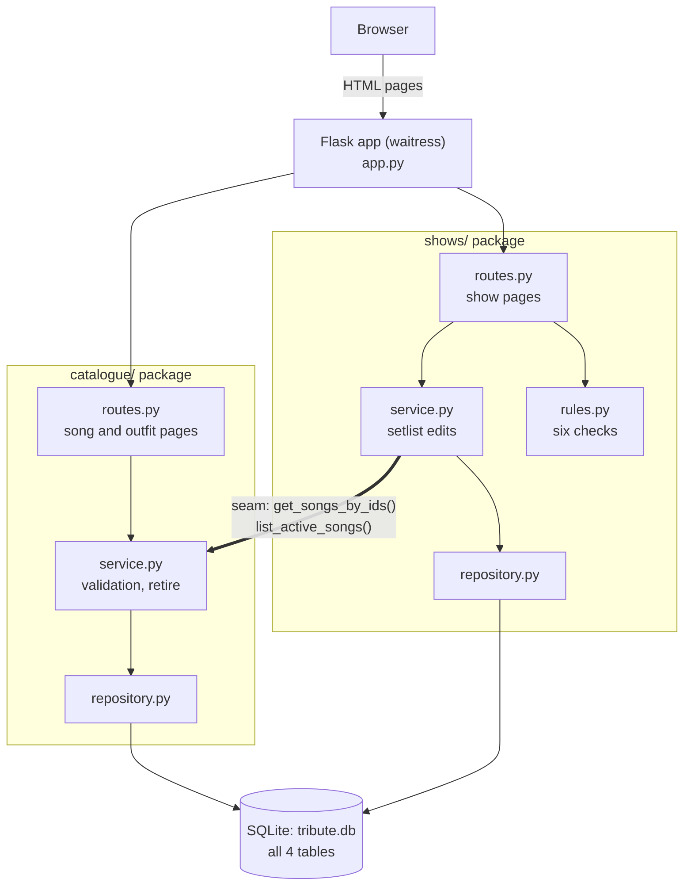
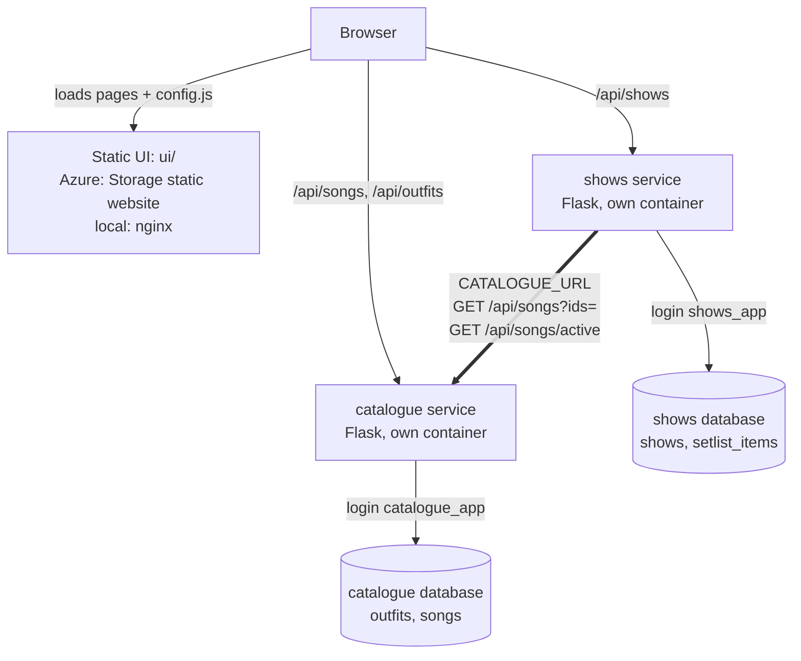
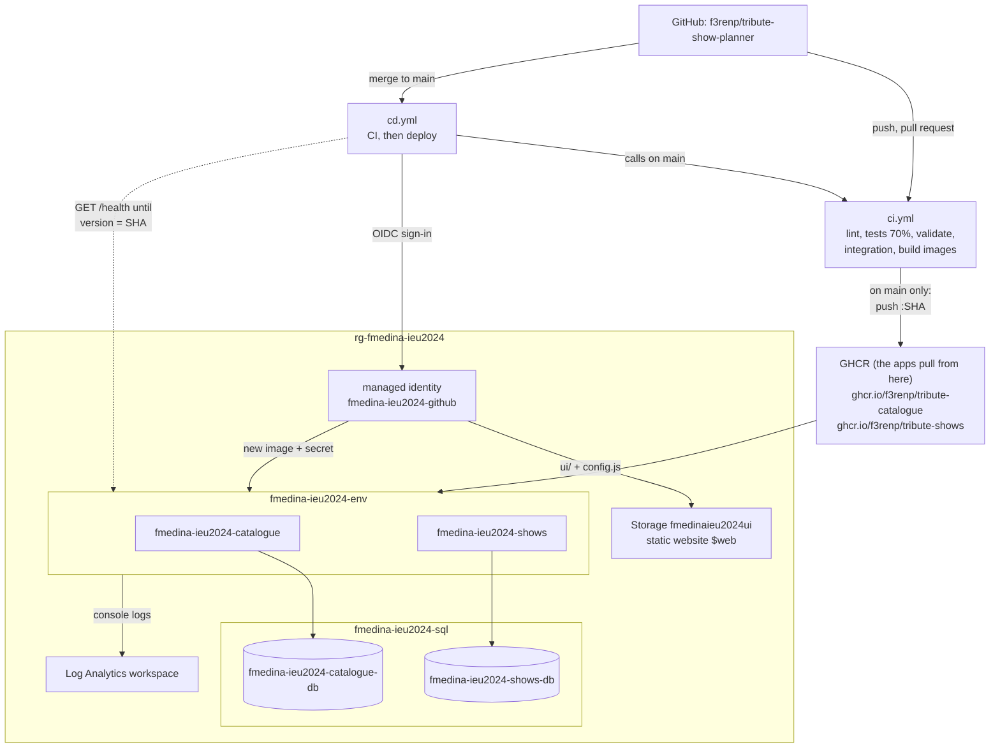
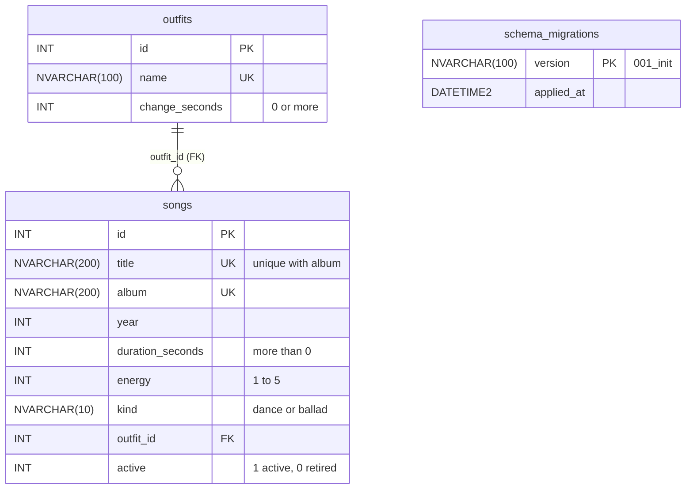
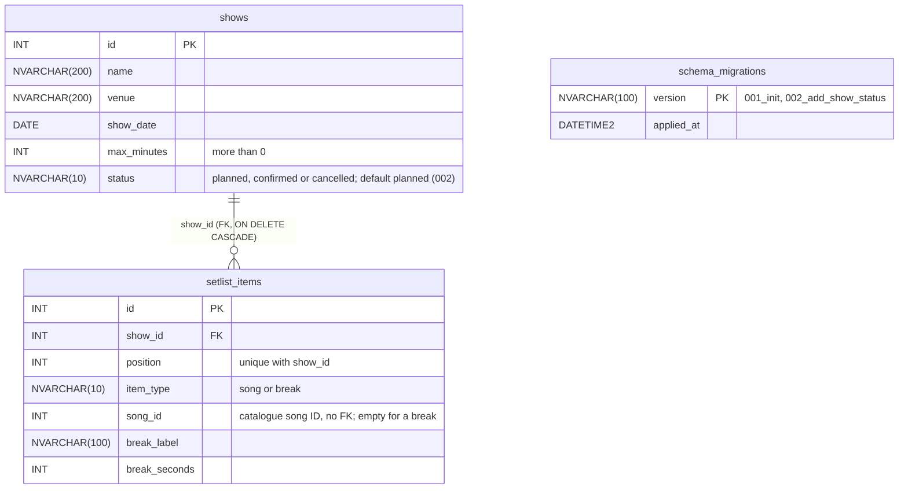

# Diagrams

Written in Mermaid, so GitHub draws them when this file is opened. Each
one is kept small so it stays readable at full page width in the report.
They describe the system as deployed on 22 Nov 2026 (commit e6c8bc2 and
later), except the first one, which is Assignment 1.

## 1. Architecture before: the Assignment 1 monolith

One Flask app in one container, with server-rendered pages and one SQLite
file. The thick arrow is the seam: the only place where the show builder
used the catalogue, through two Python functions.

## 2. Architecture after: two services, one database each

The UI is static files; the browser calls both services' JSON APIs, at
the URLs in `config.js`, and each service accepts browser calls only from
the UI's origin (`CORS_ORIGINS`). The thick arrow is the seam, now an HTTP
call from shows to the catalogue at `CATALOGUE_URL`, with a 5 s timeout.
No service reads the other's database.

If the catalogue does not answer within 5 s, shows still serves the
overview from its own database, without song details and with the checks
skipped, and refuses to add songs (503).

## 3. Deployment

Every change goes through a pull request. A merge to `main` runs `cd.yml`,
which calls `ci.yml` again on that commit; on `main` its images job also
pushes the SHA-tagged images, and only then does `cd.yml` deploy them. The
pipeline signs in with OIDC as the managed identity: no password exists.
Everything on Azure is in `rg-fmedina-ieu2024` (swedencentral).

Each Container App runs 0 to 1 replicas; each database is serverless on
the free offer and pauses after 60 minutes without connections (ADR-8).

## 4. Databases, one per service

These match the migrations: catalogue `001_init.sql`; shows `001_init.sql`
and `002_add_show_status.sql`. `schema_migrations` is created by
`app/migrate.py` and records each applied file.

### Catalogue database

### Shows database

`setlist_items.song_id` is a plain ID with no foreign key: the songs are in
the catalogue's database, so shows checks the song over HTTP when it is
added (ADR-3, ADR-7). A break item has no `song_id`.

