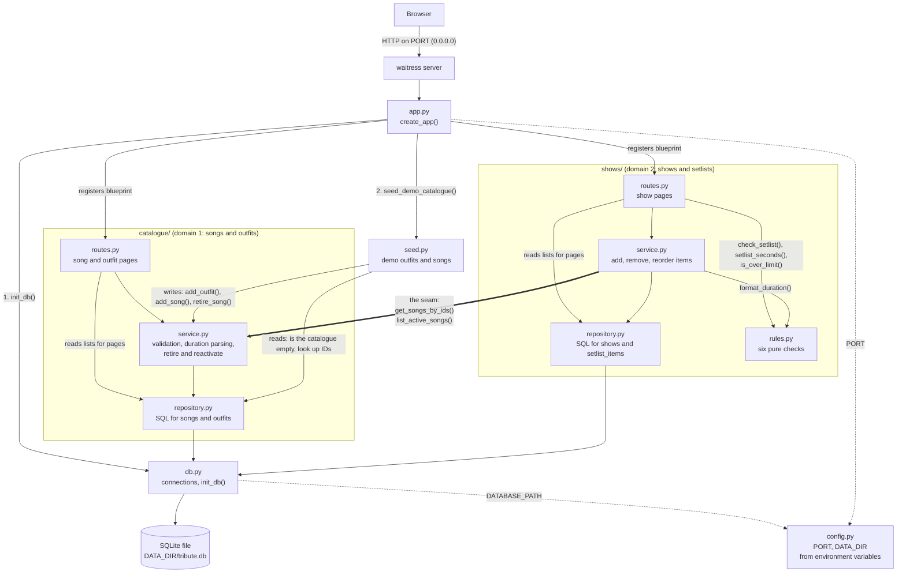
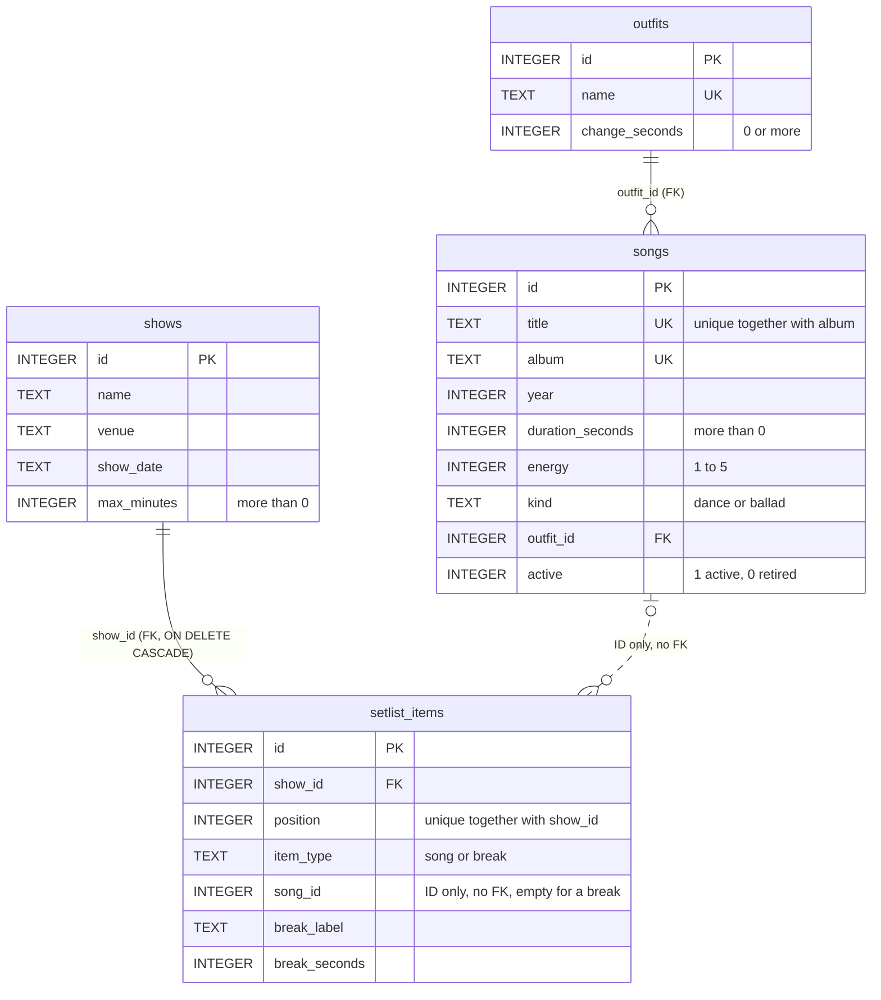

# Diagrams

Both diagrams are written in Mermaid, so GitHub draws them when this file
is opened. They describe the code as it is in the repository.

## Architecture

One process: `python app.py` starts waitress, which serves the Flask app
built by `create_app()`. Arrows point from the file that calls to the file
it calls. The thick arrow is the seam, the only place where the show
builder uses the catalogue.

## Database

Four tables in one SQLite file. Solid lines are real foreign keys. The
dashed line is not a foreign key: `setlist_items.song_id` stores only the
song's ID, and the show builder gets the song details through the
catalogue service (ADR-3). A break item has no `song_id`.

